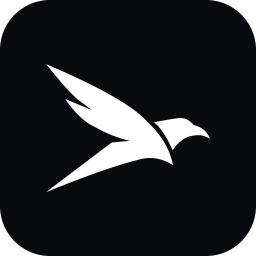
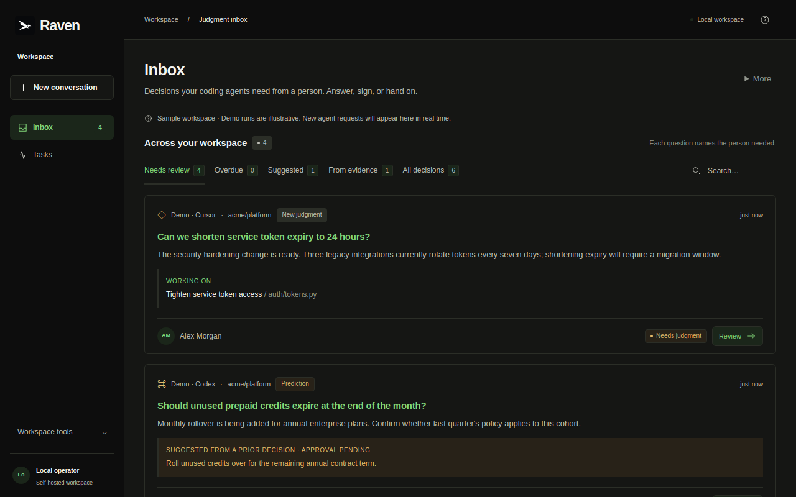
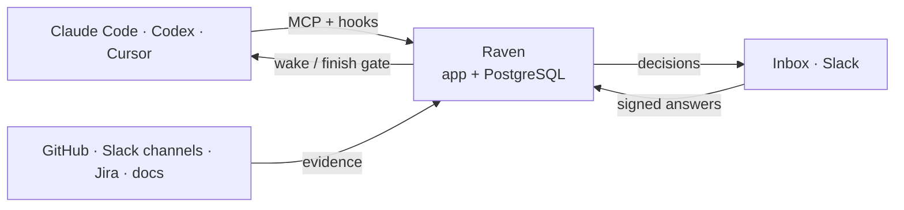

<p align="center">
  
</p>

<h1 align="center">Raven</h1>

<p align="center"><strong>Your coding agents do the work. Raven gets them the human judgment they need.</strong></p>

<p align="center">
  <a href="docs/getting-started.md">Getting started</a> ·
  <a href="docs/getting-started.md#3-connect-your-coding-agent">Connect your agent</a> ·
  <a href="docs/overview.md">How it works</a> ·
  <a href="docs/reference.md">Reference</a> ·
  <a href="docs/README.md">All docs</a> ·
  <a href="docs/verification.md">What we have tested</a>
</p>

<p align="center">
  <a href="https://github.com/nintendo-ds75/raven-preview/actions/workflows/ci.yml"></a>
  <a href="LICENSE"></a>
  
  
</p>

A feature can be easy to code and still take a week, because someone has to decide
which usage is billable, whether a customer gets an exception, or what the default
should be. Raven is a self-hosted MCP server that sits between your coding agents
and your organization: it registers each task, finds the decisions a person has to
make, routes them to the right owner with the evidence, records the signed answer,
and wakes the agent to continue. Nothing ships on an answer nobody signed.

<p align="center"></p>

## Quick start

Requires Docker Desktop or Docker Engine 24+ with Compose v2, and about 4 GB of memory.

```sh
git clone https://github.com/nintendo-ds75/raven-preview.git
cd raven-preview
./setup
```

`./setup` builds the app, starts PostgreSQL and prints `http://localhost:7333`. The
first build took 45 seconds and the first start 11 seconds on an M1 Pro laptop
(16 GB, Docker 29, fast connection, 2026-10-18); it downloads about 1 GB of base
images, wheels and a small embedding model, so a slow link is what makes it longer.
The browser opens **Create your workspace**; the setup credential it asks for comes
from `./dev login`.

Then connect the agent you already use, from the checkout it works in:

```sh
./setup --configure --project /path/to/your/code --client claude    # or codex, cursor
```

That writes the MCP configuration and, for Claude Code and Codex, the hooks that
register each task before the model starts. Restart the agent, and give it a task
in your own words. The decisions it finds appear in your inbox. Full walkthrough:
[getting started](docs/getting-started.md).

<details><summary>Connect without the wizard</summary>

In the browser, **Connections & setup → Connect** mints a limited credential and shows one command per client, for example:

```sh
claude mcp add --transport http bridge http://localhost:7333/mcp --header 'Authorization: Bearer brg_…'
```

Add the Raven rule it offers to `CLAUDE.md` or `AGENTS.md`, so the agent calls `bridge_start_task` at the start of every task.
</details>

## What you get

- **Decisions, not tickets.** The agent writes each judgment call as a node on the task's tree: the question, its context, the options and what each leads to. [How a task unfolds](docs/overview.md#the-decisions-inside-a-task)
- **Routing from evidence.** CODEOWNERS, commit and review history, imported records and earlier answers decide who is asked, and every message says why. No ownership spreadsheet to maintain. [Who does Raven ask?](docs/overview.md#who-does-raven-ask)
- **Answers from memory, signed by people.** When the records or a past decision already answer the question, Raven proposes that answer with its citation. The owner still signs; a cache hit is not approval.
- **A finish gate.** `bridge_finish_task` is refused while a decision is unsigned, and a corrected answer puts the work that leaned on it up for review. [Change proof](docs/change-proof.md)
- **People answer where they are.** In the Raven inbox, or from a Slack notification that links to the task. Replies are read back before anything is recorded. [Slack](docs/slack.md)
- **Context the agent can cite.** GitHub sync plus opt-in Slack channels, Jira projects and documentation sites; Raven can scan a repository and suggest which to connect. [Context sources](docs/context-sources.md)
- **Agents keep working.** A hook holds the agent while a person answers, or a local supervisor resumes the same session later. [Host adapters](docs/host-adapters.md)
- **Or run the agent in Raven.** Start a task from the browser and Raven runs Claude in a private copy of the repository, with tests in a no-network sandbox. [Browser tasks](docs/browser-tasks.md)
- **Today (preview).** Raven can investigate imported evidence (meeting transcripts, notes, connected sources) and suggest one bounded piece of work with the evidence behind it. A person reviews and signs it in the same inbox before any coding worker runs. Needs a model backend and the optional browser execution; not yet exercised with a live provider. [Today](docs/startup-os.md)

## How it works



Everything runs on your machines. Raven's core is standard-library Python with
PostgreSQL (or SQLite for a single-operator install). Model calls, when you enable
them, go to the provider you configure; Slack, GitHub and Jira use the accounts you
connect. [Where your data goes](docs/overview.md#your-instance-and-your-data)

## Integrations

All optional. Raven works with the inbox alone.

| Integration | What it adds | Guide |
| --- | --- | --- |
| GitHub | Pull requests, reviews and CODEOWNERS as routing evidence, kept in sync | [GitHub connection](docs/github-connection.md) |
| Slack | Notifications with a link to the decision; an opt-in conversational mode | [Slack](docs/slack.md) |
| Jira, Slack channels, docs sites | Records the agent can search and cite, each attested as shared with every reader | [Context sources](docs/context-sources.md) |
| Anthropic or OpenAI key | Model-assisted triage, briefs, proposals and diff review | [Reference](docs/reference.md) |

## Operate

```sh
./dev status    ./dev logs    ./dev down    ./dev up    ./dev backup
```

`git pull && ./dev up` upgrades; migrations are additive. Hosting, HTTPS, backups
and the data flow of each integration: [DOCKER.md](DOCKER.md). Standing up one team:
[PILOT.md](PILOT.md).

## Status

Raven is a supervised pilot preview. Real coding agents have completed tasks through
it end to end against frozen open-source repositories, with simulated people; the
reports, including the failures, are in [what we have tested](docs/verification.md).
Discovery is not guaranteed, a first contact can need correction, and the diff review
does not replace tests or code review.

## Contributing

Run what CI runs with `make check`; see [CONTRIBUTING.md](CONTRIBUTING.md). Commits
follow conventional commits.

## License

[Raven Source Available License 1.0](LICENSE). Free for personal and noncommercial
use. Commercial use gets one 90-day trial per organization, then needs a team
license. Not an OSI-approved open-source license; the `bridge` package, `bridge_*`
tools and `BRIDGE_*` settings keep their names for compatibility.
