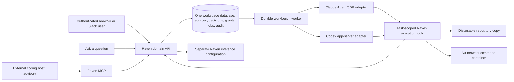

# Workbench implementation and verification plan

Baseline: `82a1a9c`. This is an implementation plan, not a release certificate.
The existing browser executor uses a custom Messages loop. It is not a Claude
Agent SDK or Codex host, and its earlier tests do not verify those integrations.

## Boundaries

The host orchestrates code work. Raven owns evidence, authority, decisions and
continuation. Neither a host message nor ordinary browser chat signs a decision.
The authenticated decision form remains the write boundary. Workspace databases
are separate deployment boundaries; a shared database is not a multi-tenant service.

Provider inference receives selected prompts, source excerpts and tool results.
Local execution does not mean local inference. Provider session data is distinct
from Raven's domain history. Changing providers must create a different session.

## Implementation slices

1. Add real host adapters, capability diagnostics and separate host settings. Keep
   existing tests explicitly scripted. Never substitute the Messages loop when a
   selected host is unavailable. Pin and verify the supported interfaces.
2. Persist host checkpoints, normalized events and tool intents. Claim before
   action; reconcile uncertain effects instead of replaying them. Make pause,
   cancellation, restart and duplicate answer races testable.
3. Add provider selection and question-only entry, explicit inbox answer states,
   and task evidence/continuation visibility. Test keyboard and narrow layouts.
4. Audit connector revocations and recipient permissions throughout retrieval,
   traces and resumed contexts. Preserve historical signatures while invalidating
   current authorization when its dependencies change materially.
5. Verify contact learning separately from delegated authority; test solo setup,
   bounded work, the billing example's independent and blocked branches, and
   source-grounded recall.
6. Freeze adversarial fixtures and forbidden outcomes before the release run.
   Retain failures, run mutations, fingerprint evidence and report live versus
   simulated results. Keep statistical quality experiments separate from release
   regressions. Run fresh-install and upgrade checks against the delivered SHA.

## Schema and migration plan

Use additive, idempotent tables beside `browser_tasks`, leaving existing history
and signatures intact. Host sessions hold adapter/version, checkpoint, state,
generation and budget. Tool intents hold task, call ID, arguments fingerprint,
pending/completed/unknown state and result. Unique keys make duplicate delivery
observable. Migrations run on both SQLite and PostgreSQL and must tolerate repeat
startup. No migration promotes old answers into trusted grants.

Use database transactions/outboxes and fenced claims before introducing another
orchestrator. Temporal would introduce deployment and migration work without
removing the need for domain transactions and effect reconciliation. Revisit only
after measured queue/recovery limits. Existing unified source/decision tables stay
the authority; a separate search service, if justified by measurement, is an index.

## Requirement map and verification

| Requirement | Existing boundary | New verification |
| --- | --- | --- |
| Real Claude and OpenAI hosts | `workbench.py`, external `host_sessions.py` | Adapter protocol tests plus live tool/wait/reply/resume/patch sessions |
| Internal inference separate from host | `config.py`, `llm.py` | Independent model, credentials, budgets and errors |
| Solo inbox; no chat approval | `server.py`, `authz.py`, decision forms | Exact revision, stable actor ID, duplicate/stale submission, visible next step |
| Shared evidence and memory | `context_memory.py`, source revision and support services | Scope/conflict/exception/version and poisoned-memory probes |
| Revoked access | `sources.py`, source connectors, retrieval/export | Revocation/timeout/delete/disable and active-session contamination tests |
| Durable continuation | `workbench.py`, `host_sessions.py`, `mcp_events.py`, `delivery.py` | Crash windows, duplicate callbacks, fences, zero idle inference |
| Task observability | `canvas.py`, task trace, `workbench.js` | Evidence before action, host state, branch blockers, redacted stable trace |
| Guarded versus advisory | `workbench_fs.py`, host tool policies | Denied alternate shell/network/MCP paths; honest capability labels |
| Install and upgrades | Docker, graph migrations, onboarding | Clean volume and representative existing state; no Slack required |
| Auditable evaluation | `evals/`, `bench/`, existing tests | Frozen oracles, 100 declared trials, mutation gates and integrity verification |

Each adversarial group A–J requires ten predeclared executions (four scenarios
twice plus two harder variants), including blocked live cases in the denominator.
Offline adapter fixtures do not satisfy live Claude or OpenAI acceptance. A frozen
historical checkout prevents supplied future data, not model pretraining knowledge.
Real human usability findings require real participants; synthetic interaction tests
must not be presented as a human study.

## External acceptance prerequisites

Live provider tests need authorized test credentials for each selected provider.
Real Slack installation and human usability sessions require separate test access
and participants. Unsupported voice functionality remains explicitly unavailable.
Missing prerequisites block those acceptance gates, not unrelated implementation.

Completion requires a report tied to the final SHA, reproducible commands and
remaining blockers. This plan alone makes no claim that the release gates pass.

## Implementation checkpoint, 13 October 2026

Real Claude browser execution, saved sessions and tool intents, explicit provider
settings, read-only questions, and source-access withholding are implemented.
A complete Docker customer machine ran in Daytona. The live task produced a
patch with five signed decisions and 339 passing generated-code checks, then
explicitly requested manual review because automatic conformance was incomplete.
[The report](../reviews/main-82a1a9c-daytona-customer.md) records the sequence and
remaining gaps. The acceptance prerequisites and broader release gates above
are still open; this checkpoint does not claim completion of that plan.
